<p align="center">
  
</p>
<p align="center">
  
</p>

<br>

**A coffee today. Enough for the bus tomorrow.**

A money journal for Algerian students. Spread your allowance across the days until your next payment. Log coffee and bus fares, set money aside for books, and track money lent or borrowed. Your records stay on your phone.

<sub>ALGERIAN DINARS / WORKS OFFLINE / NO ACCOUNT</sub>

<p align="center">
  <a href="#a-day-with-waffir">A day with Waffir</a> ·
  <a href="#money-between-friends">Loans</a> ·
  <a href="#set-money-aside">Plan</a> ·
  <a href="#before-your-first-lecture">First budget</a> ·
  <a href="#the-maths-behind-the-day">The maths</a> ·
  <a href="#run-it-yourself">Build it</a>
</p>

---

## A day with Waffir

<table>
  <tr>
    <td width="42%" align="center">
      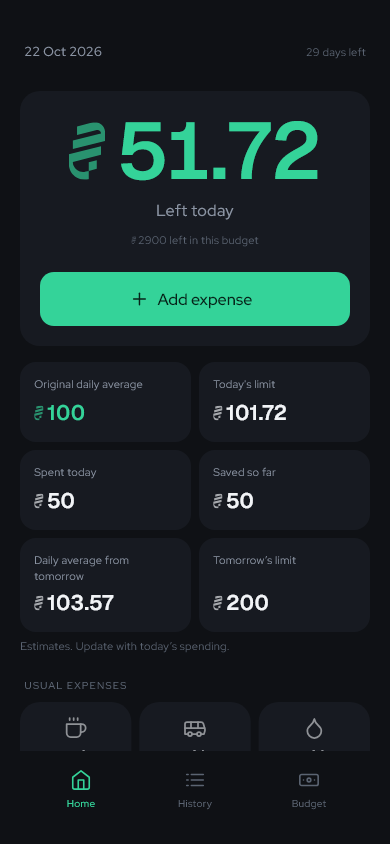
    </td>
    <td>
      <h3>One number before you spend.</h3>
      <p>Open Home. <b>Left today</b> tells you what remains of today's allowance.</p>
      <p>Below it: today's spending, savings or shortfall, and the next day's estimates. Planned purchases have their own reserved money.</p>
      <p>Your usual coffee? One tap.<br>Books next week? <b>Add plan.</b><br>Something different today? <b>Add expense.</b></p>
      <hr>
      <p><b>Yesterday</b> helps set today's limit.<br><b>Today</b> has its own spending room.<br><b>Tomorrow</b> updates as you spend.</p>
      <p><sub>Screen shown with sample data.</sub></p>
    </td>
  </tr>
</table>

### Five places for your money

| Tab | What you do there |
| --- | --- |
| Home | Check ordinary money left today, daily figures, reserved plans, and open loans. |
| History | Search expense logs and correct active or saved budgets. |
| Loans | Track money owed to you and money you owe, with repayments and reminders. |
| Plan | Reserve future expenses, review missed days, and record actual purchases. |
| Budget | Edit your budget, manage usual products, or Stop and Save. |

All screenshots below come from the current app with sample records. They do not show personal financial data.

### Small purchases, written down

You remember the big payment. Coffee, water, and snacks are easier to forget. Give each purchase a name and icon, choose its time, then save it. Add your own usual products with a name, price, and icon during setup or later in Budget. Their buttons appear on Home only when you have products.

| Between classes | At the end of the day |
| --- | --- |
| Tap a saved product to log its usual price. | Open History and search by name. |
| For a new expense: amount → Continue → name, icon, time → Log it. | Correct a name, amount, icon, date, or time. Delete a mistake after confirmation. |
| Choose your own prices and products. | Keep the record, even after you close the budget. |

<p align="center">
  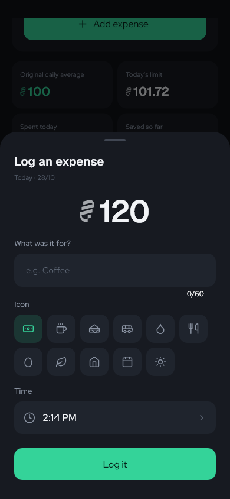
  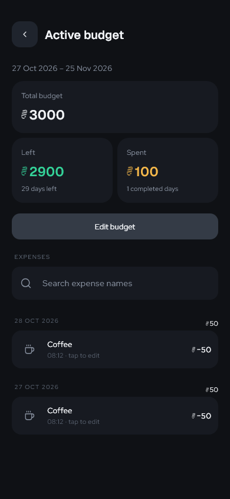
</p>
<p align="center"><sub>Write it down. Find it later. Fix it if needed.</sub></p>

## Set money aside

**Books on Monday. A bus pass next week. Keep their money ready.**

The **Plan** tab reserves an estimated amount for one day or several selected days in your active budget. Choose **Total**, **Per day**, or **Custom**, add a label and icon, then check the split and daily-limit preview. A total of 100 DA over three days becomes 34, 33, and 33 DA. Custom lets you enter a different estimated amount for each day. Tap a date or amount to correct it before saving.

| Mode | Example |
| --- | --- |
| Total | Split 100 DA across three days: 34, 33, 33. |
| Per day | Reserve 100 DA for each selected day. |
| Custom | Reserve 50 DA today and 150 DA tomorrow. |

<p align="center">
  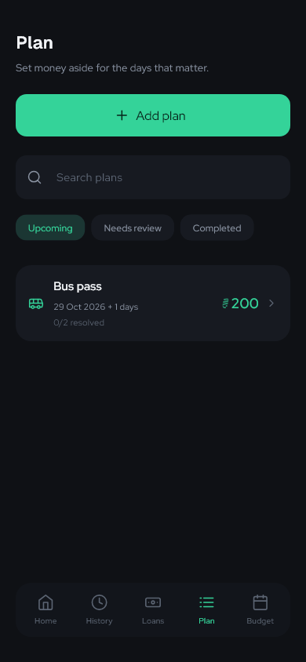
  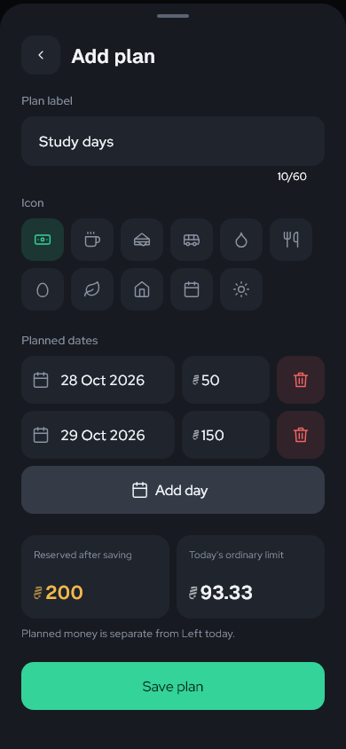
</p>

- Search plans or filter **Upcoming**, **Needs review**, and **Completed**.
- Home shows **Planned spending** and **Next plan**. Reservations reduce ordinary spending limits but do not change cash or the original daily average.
- On the planned day, record the actual expense. Change the amount, label, icon, date, or time if needed. Saving replaces that day's reservation with one expense in History.
- Missed days keep their reservation until recorded, moved, or cancelled. Plans above available cash need confirmation.
- Correct a linked expense in History or Plan. Deleting it restores its reservation. Deleting the plan keeps recorded expenses.
- When a budget stops, unfinished days stay available for review. Move them to dates in the active budget. Completed days stay linked to their saved budget.

Date and amount inputs are separate. Tap a date to open the calendar, tap an amount to edit its estimate, or use the red trash button to remove a pending day. Preview cards show total reserved money and the ordinary daily limit before saving.

<p align="center">
  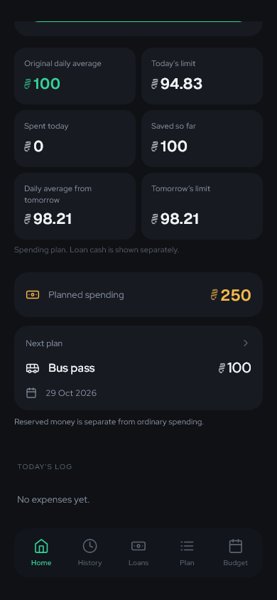
</p>

## Money between friends

**Books for a friend. Bus money borrowed until next week. Keep both in view.**

Loans has two clear directions: **Owed to me** and **I owe**. Save the person's name, amount, loan date, and an optional due date and note. The popup shows the effect on your budget before you save.

| Keep track | Settle up |
| --- | --- |
| Filter by All, Owed to me, I owe, or Paid. | Record part of a repayment or the full amount. |
| Search by person or note. Overdue loans appear first. | See the unpaid balance and payment history. |
| Edit details if you made a mistake. | Correct payments or delete them after confirmation. |

<p align="center">
  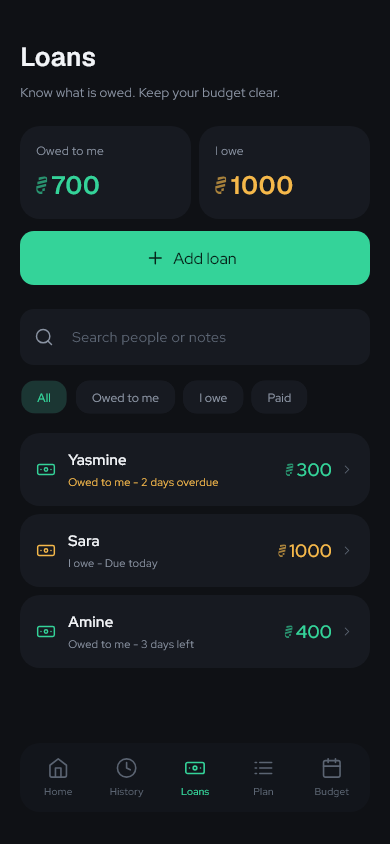
  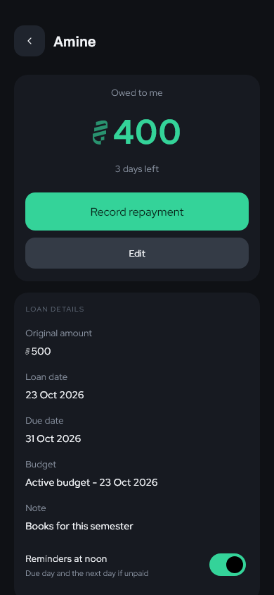
</p>

### Cash in hand, money expected back

Loan transfers change cash. They do **not** count as expenses or savings.

- **You lend:** cash falls at once. If repayment is due within the budget period, the planned daily limit can include that expected money until the due date ends. With no due date, a due date after the budget ends, or an overdue balance, the unpaid amount reduces the limit.
- **You borrow:** cash rises. Money owed within the budget period, or without a due date, is reserved for repayment. Borrowing due after the period can increase the spending limit, while the debt remains visible.
- **You record a repayment:** cash and limits update. Payments cannot exceed the amount still owed. A transfer above available cash needs confirmation.

Home separates cash, expected repayments, repayment reserves, and planned spending. If Left today depends on money that has not returned, it shows a warning. Loan transfers affect cash and today's available limit. They do not count as expenses or savings. Future spending estimates use the budget, logged expenses, and unfinished plan reservations; they do not add loan cash movements.

Loans stay open when a budget closes. Each transfer has its own budget link, or **Outside a budget**. A repayment in a later budget affects that budget; old loans do not add money to a new budget automatically. Existing links and carry-over amounts stay fixed after budget corrections.

### A reminder at noon

Dated loans can send a phone notification at **12:00 PM local time** on the due day and once the next day if money is still owed. The alert shows the unpaid amount and direction, with no person's name. Tap it to open the loan.

Reminders are on by default for dated loans and can be switched off per loan. Waffir asks for notification permission when needed. A late entry can trigger one immediate reminder. Partial payments update the amount; full repayment or deletion cancels the alerts. Android may delay scheduled alerts to save battery.

<details>
<summary><b>See the repayment popup</b></summary>

<p align="center">
  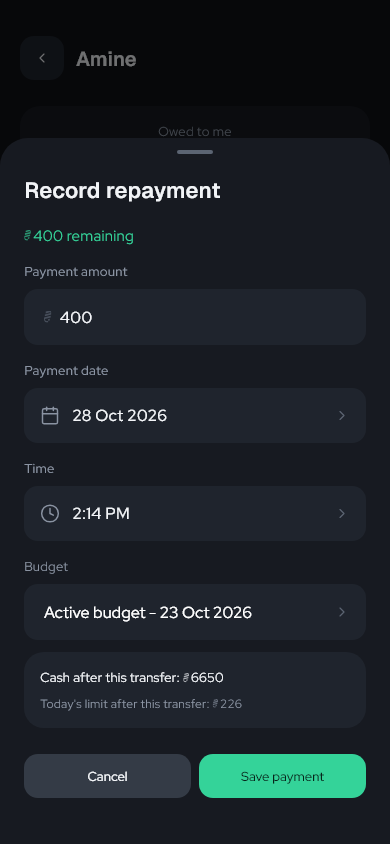
</p>

</details>

## Before your first lecture

**Choose a period. Add your money. Save your usual purchases.**

Use a **7, 15, 21, or 28-day** shortcut, or choose dates that match your next payment. The duration appears directly below the date inputs. Both the start and end dates count. Enter the full budget in whole dinars. Products are optional and can be added later.

<details>
<summary><b>See the three setup screens</b></summary>

| Your dates | Your amount | Your everyday purchases |
| :---: | :---: | :---: |
| 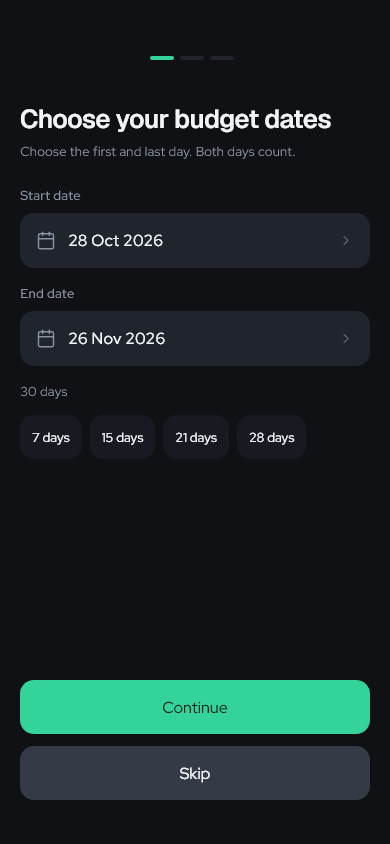 | 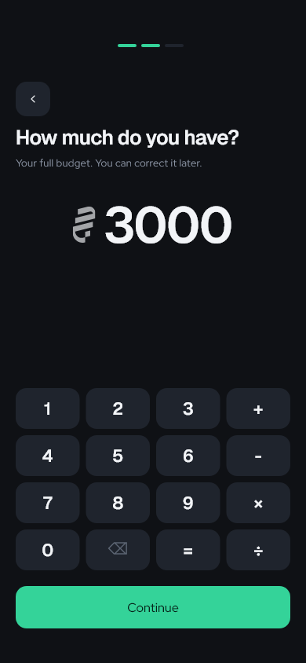 | 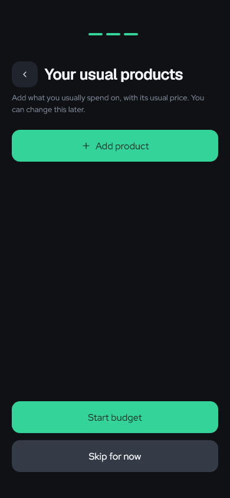 |

</details>

### Calculate before you save

Amount inputs accept `+`, `-`, multiplication, and division. For example, `340/5` gives **68 DA**, and `120+250` gives **370 DA**. Multiplication and division are calculated before addition and subtraction. Tap **=**, Continue, or Save to calculate.

The saved result must be a positive whole amount in dinars. Invalid calculations, division by zero, and fractional final amounts are rejected. The amount keypad is shared by budget setup, expense entry, loans, and plans.

## When plans change

<table>
  <tr>
    <td>
      <h3>Your budget can change with you.</h3>
      <p>Entered the wrong amount? <b>Edit</b> it.<br>A usual price changed? Update the product.<br>Starting a new period? <b>Stop and Save.</b></p>
      <p>Keep the old budget in History. Start the next one with the positive balance left, or enter a new amount.</p>
      <p>Past logs keep their prices when a product changes. Money already carried forward stays fixed when you correct an older budget.</p>
    </td>
    <td width="42%" align="center">
      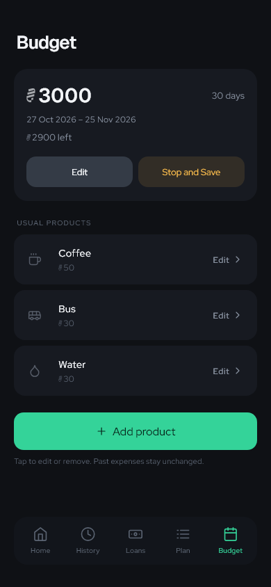
    </td>
  </tr>
</table>

## The maths behind the day

With no loans or planned reservations, suppose you set **3,000 DA for 30 days**. Your original daily average is **100 DA**. If you spend **50 DA on day one**:

| Figure | Result | Meaning |
| --- | --- | --- |
| Original daily average | 100 DA | Full budget ÷ all budget days. |
| Today's limit | 100 DA | Today's allowance, fixed before today's purchases. |
| Spent today | 50 DA | Purchases logged today. |
| Left today | 50 DA | Today's ordinary limit minus ordinary spending today. |
| Daily average from tomorrow | 101.72 DA | 2,950 DA spread over the next 29 days. |
| Tomorrow's limit | 150 DA | Maximum for tomorrow that leaves the original average for each later day. |

**Saved so far** compares the original allowance for completed days with expenses recorded on those days. Today is excluded until it ends. A negative result appears as **Over budget so far**.

For the future figures:

```text
Reserved = total estimates for unfinished planned days in this budget
Future average = (budget - all expenses - Reserved) / days after today
Original-plan limit = 2 × original average + savings - spent today - Reserved
Tomorrow's limit = maximum of 0, Future average, and Original-plan limit
```

This uses savings for tomorrow when the original allowance can still be kept for later days. After overspending, it spreads the shortfall across the remaining days instead of charging the full shortfall tomorrow. Tomorrow's limit is zero when no unreserved money remains. On the last day, future figures show **No days remaining**.

**Reservations are separate from ordinary spending.** Reserving 300 DA from a fresh 3,000 DA, 30-day budget leaves an ordinary daily limit of **90 DA**. Recording that planned expense for 300 DA releases its reservation and leaves the ordinary limit at **90 DA**. It does not subtract the same purchase twice. The expense is still included in Spent today and future savings comparisons.

Ordinary purchases reduce Left today without recalculating today's limit. Adding or changing a plan, recording a planned purchase, and changes to loans can update that limit. At zero or below, Home shows **Stop for today** for ordinary spending. Cash and shortfalls stay visible separately from reserved purchases.

<details>
<summary><b>Small details that matter</b></summary>

Waffir uses a dark theme, mint primary actions, gray Edit and secondary buttons, and amber warnings. Delete actions use muted red with red text; confirmation buttons remain red. **Geist** stays on headings and key amounts. **Red Hat Display** is used for body text, labels, and controls. Font licenses are bundled with the app.

The supplied [dinar symbol](assets/dzd.svg) appears to the left of amounts with reduced opacity. Product icons are also muted. Fields have separate labels, placeholders, and no visible outlines. Standard actions share a 54 px minimum height, 16 px text, and medium weight. Edit and Stop and Save use the compact button size. Compact actions use a 44 px minimum height. Back controls share a dark rounded surface. The inset tab bar is darker than the section cards; content is visible through its rounded top corners and hidden below it. Plan uses a list icon; History uses a clock. Plan date fields, amount fields, and their red trash buttons share the standard 54 px height. Filters, labels, input controls, cards, and actions use shared components. Related controls use tighter spacing than separate sections.

| Icon | Example use |
| --- | --- |
|  | Coffee or tea |
|  | A snack |
|  | Transport |
|  | Water |
|  | Lunch or dinner |
|  | Other spending |

These are examples. You choose the label and icon. Changing a usual product's price affects future taps; past logs keep their recorded amounts.

</details>

## Your records, on your device

- Budgets, products, expense logs, loans, repayments, and plans are stored locally using SharedPreferences. There is no cloud sync or export feature.
- Clearing app data or uninstalling the app can remove your records.
- Saved budgets remain editable, but cannot receive new expenses.
- Money carried into a new budget stays fixed if you later correct the old budget.
- Budget date edits cannot exclude existing expenses or unfinished planned days. Correct the expense or move or cancel the planned day first.
- Older budget data is migrated without adding invented plans. The original legacy storage key is retained for recovery.
- Changes become visible only after a successful save. A failed save keeps the previous records and reports an error.

## Run it yourself

<details>
<summary><b>Flutter setup, checks, APK build, and source map</b></summary>

Current release: **0.5.0+1**. The shared Android release is ARM64 and about **18.62 MiB**. It includes Plan and Custom daily estimates.

This is a Flutter project. Install Flutter and the Android SDK, then run:

```sh
flutter pub get
flutter run
```

Check the code and user flows:

```sh
flutter analyze
flutter test
flutter test test/presentation/design_capture.dart
flutter test test/presentation/loans_flow_test.dart test/presentation/plan_flow_test.dart
```

Build smaller APKs for each processor type:

```sh
flutter build apk --release --split-per-abi --split-debug-info=build/symbols/android
```

The generated ARM64 output is `build/app/outputs/flutter-apk/app-arm64-v8a-release.apk`. Shared APKs use `waffir-release-<version>+<build>.apk`, such as `waffir-release-0.5.0+1.apk`. Build outputs are not stored in Git. Keep the debug symbol files with the release. Android's internal update code includes the release version so build counters can restart without blocking updates. The current Android build uses the debug signing key; set a production key before store distribution.

The code uses a layer-first structure:

```text
lib/
  main.dart                 # Supplies storage and phone notifications
  domain/
    models/                 # Budgets, expenses, loans, plans, and daily figures
    rules/                  # Expense rules and loan reminder planning
    repositories/           # Typed storage contract
  data/
    serialization/          # JSON schema and legacy migration
    storage/                # SharedPreferences implementation
    notifications/          # Phone permissions, scheduling, and loan links
  presentation/
    app.dart                # App theme and root navigation
    controllers/            # Validated changes, reservations, links, and durable saves
    screens/                # Home, History, Loans, Plan, Budget, and editors
    widgets/                # Shared forms, cards, lists, popups, and navigation
    design/                 # Colors, spacing, button styles, and formatting
```

Plans and estimates live in the domain; JSON migration lives in data; forms and navigation live in presentation. No extra package is needed for Plan. The domain has no Flutter or storage-plugin dependency. Presentation and data depend on the domain. `main.dart` connects them. Tests follow the same layers; `test/architecture_test.dart` checks the dependency direction and prevents shared widgets from importing screens.

</details>

---

<p align="center">
  <strong>A small habit between classes. A clearer view of your money.</strong><br>
  Waffir - made for student life in Algeria 🇩🇿
</p>

Found a bug or have an idea? <a href="https://github.com/hamza-dje/waffir/issues">Open an issue</a> with the screen, steps, and expected result. Hide personal details in screenshots.

## Dinar symbol credit

The dinar symbol used in Waffir's app icon and currency displays comes from [رمز الدينار الجزائري](https://www.behance.net/gallery/220609691/_) by [Salah Eddine Mrezegue](https://www.behance.net/Mrazag), credited in the project as Mrezag Salaheddine. The original symbol design belongs to its creator. The project states that all rights are reserved.
